# Stockly · Inventario y facturación

[](https://github.com/acostamatias220/stockly/actions/workflows/ci.yml)


Sistema **fullstack** de inventario multi-depósito y facturación para una distribuidora: productos con stock por depósito y alertas de mínimo, movimientos auditados, clientes y proveedores, facturas A/B con IVA 21% y 10,5%, numeración correlativa sin huecos, PDF y un dashboard con gráficos SVG hechos a mano.

> 🇬🇧 _Inventory & invoicing system built with ASP.NET Core 10 (clean layered architecture, EF Core + MySQL, FluentValidation, JWT roles), Angular 22 (standalone components, signals, zoneless) and hand-made SVG charts. Stock changes and invoice numbering are transactional and concurrency-safe; PDF invoices with QuestPDF; server-side paging/sorting/filtering, CSV export, unit + integration tests against real MySQL, Docker and CI._

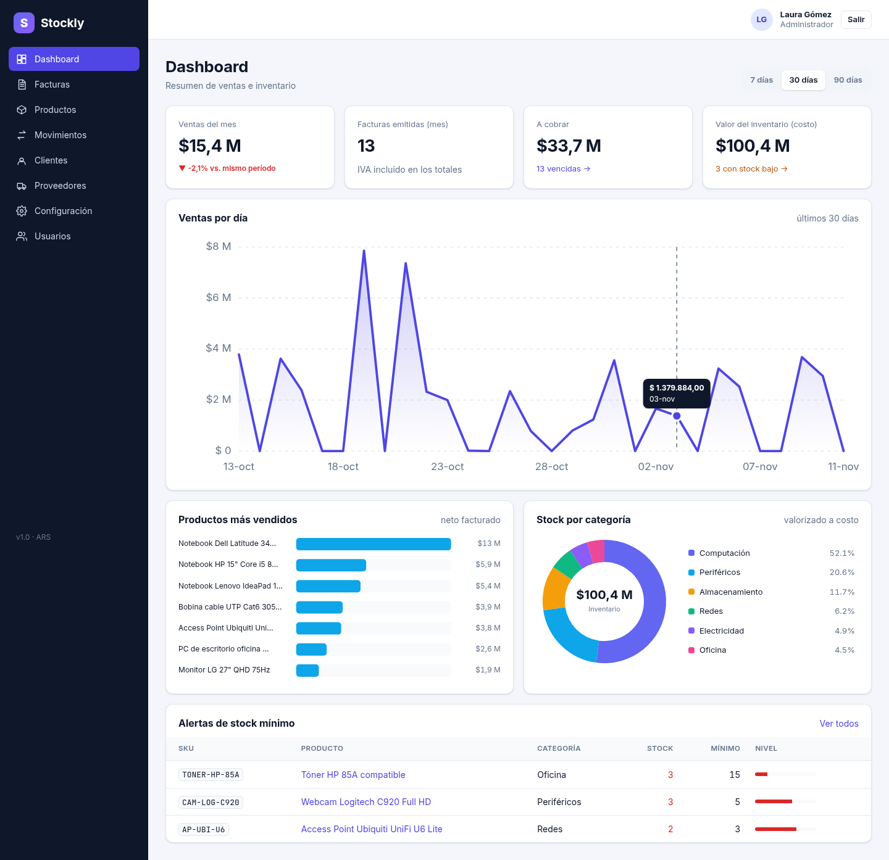

---

## ✨ Funcionalidades

- **Productos y categorías**: SKU único, precio neto, costo, alícuota de IVA, proveedor, **stock por depósito** y **alerta de stock mínimo** (con listado dedicado y KPI en el dashboard).
- **Movimientos de stock** (entrada, salida, transferencia entre depósitos y ajuste por conteo) con **auditoría completa**: quién, cuándo, motivo, referencia y saldo resultante. Las transferencias quedan vinculadas por un `correlation_id`.
- **Clientes y proveedores** con validación de **CUIT** (dígito verificador) y condición frente al IVA, que define la **letra de la factura** (A para Responsable Inscripto, B para el resto).
- **Facturas** con renglones, bonificación por renglón y general, IVA 21% / 10,5% / exento y ciclo de vida **Borrador → Emitida → Pagada / Anulada**:
  - Al **emitir** se asigna el número (`A-0001-00000042`) y se **descuenta el stock** en la misma transacción.
  - Al **anular** una factura emitida se **devuelve el stock** (solo administradores).
  - Control de concurrencia optimista: dos usuarios no pueden emitir el mismo borrador.
- **PDF** de la factura generado en el servidor con **QuestPDF** (marca de agua para borradores y anuladas).
- **Dashboard** con KPIs y **gráficos SVG propios** (línea/área, barras y anillo) sin librerías de charts: escalas, ticks "lindos", tooltips y hover.
- **Listados con paginado, filtros y ordenamiento del lado del servidor** y **exportación a CSV** (compatible con Excel, protegida contra _CSV injection_).
- **Roles** `admin`, `vendedor` y `deposito` aplicados en la API (políticas) y reflejados en la UI (guards y menú).
- **Seguridad**: JWT firmado con HMAC-SHA256, contraseñas con PBKDF2 (`PasswordHasher` de ASP.NET Identity), _rate limiting_ en login, `ProblemDetails` para errores, CORS restringido, cabeceras de seguridad y CSP estricta en nginx.

## 🧱 Stack

| Capa          | Tecnologías                                                                                                  |
| ------------- | ------------------------------------------------------------------------------------------------------------ |
| Frontend      | Angular 22 (standalone, signals, zoneless, `httpResource`), Reactive Forms, Router con lazy loading, SCSS    |
| Backend       | ASP.NET Core 10 (Web API), EF Core 9 + Pomelo MySQL, FluentValidation, JWT Bearer, Swashbuckle, QuestPDF      |
| Base de datos | MySQL 8.4 (migraciones EF Core, `CHECK` constraints, índices únicos)                                         |
| Testing       | xUnit + FluentAssertions, `WebApplicationFactory` contra MySQL real (o Testcontainers), Vitest para Angular |
| DevOps        | Docker multi-stage, docker compose, nginx (SPA + proxy `/api`), GitHub Actions                               |

## 🏗️ Arquitectura

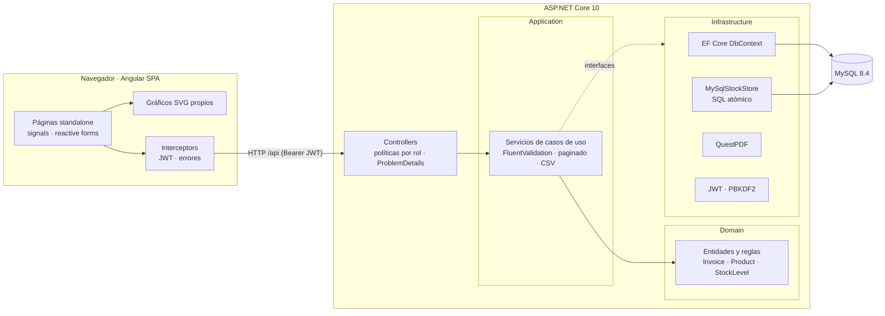

El backend sigue una **arquitectura en capas** (estilo _clean architecture_):

| Proyecto                 | Responsabilidad                                                                                               | Depende de     |
| ------------------------ | ------------------------------------------------------------------------------------------------------------- | -------------- |
| `Stockly.Domain`         | Entidades, enums y reglas de negocio puras (cálculo de factura, máquina de estados, validación de CUIT)        | —              |
| `Stockly.Application`    | Casos de uso, DTOs, validadores, paginado/ordenamiento, CSV. Define interfaces (`IAppDbContext`, `IStockStore`) | Domain         |
| `Stockly.Infrastructure` | EF Core + MySQL, migraciones, seed, stock atómico, numeración, JWT, hashing, PDF                               | Application    |
| `Stockly.Api`            | Controllers, autenticación/autorización, filtros, manejo de errores, Swagger                                   | Infrastructure |

### Emisión de una factura

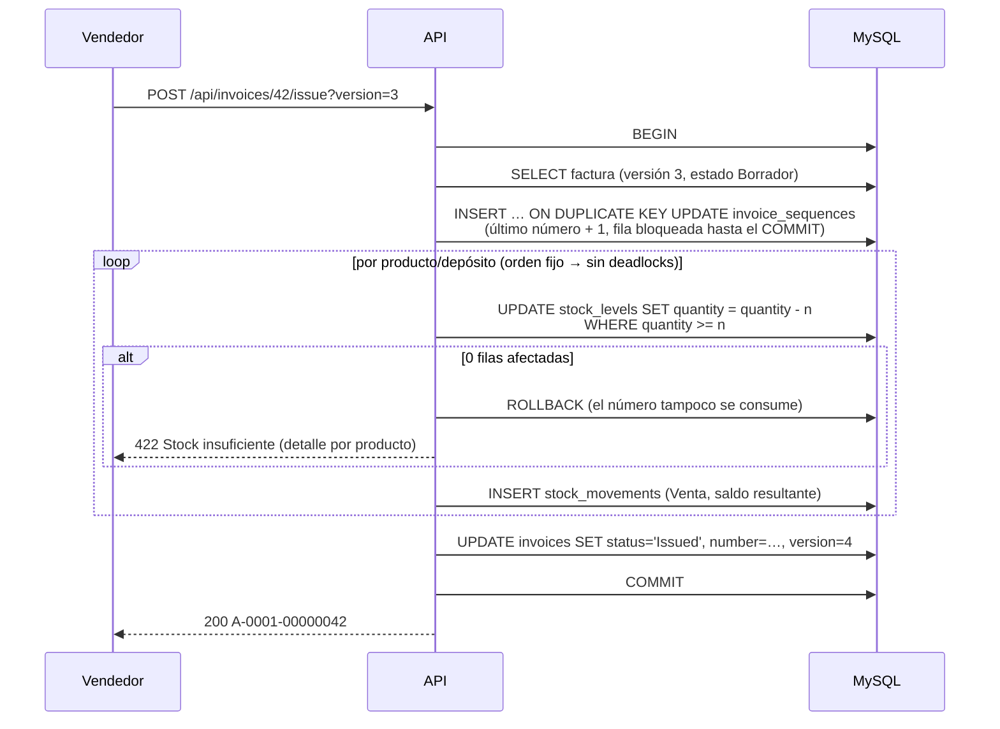

### Modelo de datos

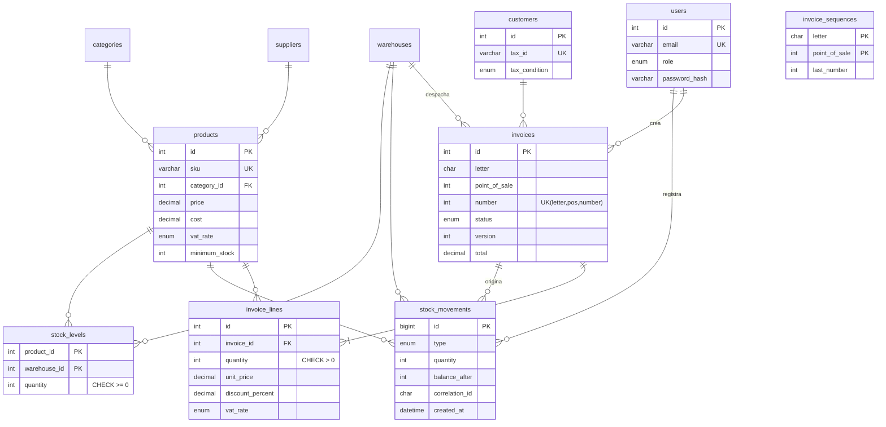

### Decisiones técnicas

- **Stock atómico y concurrente**: los descuentos se hacen con un único `UPDATE … SET quantity = quantity - n WHERE quantity >= n`. Si no afecta filas, no hay stock y se hace _rollback_ de toda la operación. Así dos ventas simultáneas nunca dejan stock negativo (además hay un `CHECK (quantity >= 0)` como red de seguridad). Las entradas usan `INSERT … ON DUPLICATE KEY UPDATE`, y los ajustes/transferencias bloquean las filas con `SELECT … FOR UPDATE` **en orden fijo** para evitar _deadlocks_.
- **Numeración sin huecos**: el número se asigna recién al emitir, dentro de la misma transacción que descuenta el stock, sobre la tabla `invoice_sequences` (una fila por letra y punto de venta). Si algo falla, el número también vuelve atrás. Un índice único `(letter, point_of_sale, number)` garantiza que nunca se repita.
- **Concurrencia optimista**: `invoices.version` es un _concurrency token_. Emitir requiere la versión que vio el usuario; si otro la modificó, la API responde `409`.
- **Cálculos en el dominio**: bonificación del renglón → bonificación general → IVA por alícuota, redondeando a centavos en cada paso (`MidpointRounding.AwayFromZero`). El frontend replica la fórmula solo para la vista previa; el servidor siempre recalcula.
- **Fechas**: todo se guarda en UTC; los "días de negocio" (vencimientos, filtros por fecha, ventas por día) se calculan en `America/Argentina/Buenos_Aires` con `TimeProvider`, lo que hace los tests deterministas.
- **Ordenamiento seguro**: el parámetro `sort` se resuelve contra una _whitelist_ (`SortMap`) por entidad; nunca se arma SQL con texto del usuario. El tamaño de página está acotado.
- **Gráficos SVG sin librerías**: funciones puras (`linearScale`, `niceTicks`, `donutSegment`, `pieAngles`) testeadas por separado, y componentes que solo calculan geometría con `computed()` de signals.

## 📁 Estructura

```
stockly/
├── api/
│   ├── src/
│   │   ├── Stockly.Domain/          # entidades, enums, reglas (Invoice, Product, CUIT…)
│   │   ├── Stockly.Application/     # casos de uso por feature, validadores, paginado, CSV
│   │   ├── Stockly.Infrastructure/  # EF Core + MySQL, migraciones, seed, stock atómico, JWT, PDF
│   │   └── Stockly.Api/             # controllers, auth, filtros, Program.cs
│   ├── tests/
│   │   ├── Stockly.UnitTests/       # dominio y aplicación
│   │   └── Stockly.IntegrationTests/# API completa contra MySQL real
│   └── Dockerfile
├── client/
│   ├── src/app/
│   │   ├── core/                    # modelos, API, auth (servicio, interceptor, guards)
│   │   ├── shared/ui/               # paginación, modal, badges, toasts, pipes
│   │   ├── shared/charts/           # gráficos SVG + utilidades puras
│   │   └── features/                # dashboard · productos · stock · facturas · clientes · …
│   ├── nginx.conf
│   └── Dockerfile
├── docs/screenshots/
├── docker-compose.yml
└── .github/workflows/ci.yml
```

## 🚀 Cómo correrlo

### Requisitos

- .NET SDK 10
- Node.js 22+
- MySQL 8.x (o Docker)

### Local

```bash
# 1. Base de datos (ejemplo con el cliente de MySQL)
mysql -u root -p -e "CREATE DATABASE stockly CHARACTER SET utf8mb4;
  CREATE USER 'stockly'@'localhost' IDENTIFIED BY '<tu-password>';
  GRANT ALL ON stockly.* TO 'stockly'@'localhost';"

# 2. Secretos de la API con user-secrets (no quedan en el repo)
cd api
dotnet user-secrets --project src/Stockly.Api set "ConnectionStrings:Default" "Server=localhost;Port=3306;Database=stockly;User=stockly;Password=<tu-password>"
dotnet user-secrets --project src/Stockly.Api set "Jwt:Key" "$(openssl rand -base64 48)"
dotnet user-secrets --project src/Stockly.Api set "Seed:Enabled" "true"
dotnet user-secrets --project src/Stockly.Api set "Seed:DemoPassword" "<password-demo>"

# 3. API (aplica las migraciones y carga los datos demo al iniciar)
dotnet run --project src/Stockly.Api      # http://localhost:5080 · Swagger en /swagger

# 4. Frontend (otra terminal)
cd client
npm install
npm start                                  # http://localhost:4200 (proxy de /api → :5080)
```

> Alternativa a user-secrets: copiar `api/src/Stockly.Api/appsettings.Development.example.json` como `appsettings.Development.json` (está ignorado por git) o usar variables de entorno (`ConnectionStrings__Default`, `Jwt__Key`, …).

El seed crea 28 productos en 6 categorías, 3 depósitos, 12 clientes, 4 proveedores, ~90 días de movimientos y ~100 facturas en distintos estados, más los usuarios `admin@stockly.dev`, `ventas@stockly.dev` (vendedor) y `deposito@stockly.dev`. La contraseña es `Seed:DemoPassword`; si se deja vacía se genera una aleatoria y se muestra en el log.

Las migraciones también se pueden aplicar a mano:

```bash
cd api
dotnet tool restore
dotnet ef database update --project src/Stockly.Infrastructure --startup-project src/Stockly.Api
```

### Con Docker

```bash
cp .env.example .env     # completar MYSQL_PASSWORD, MYSQL_ROOT_PASSWORD, JWT_KEY y SEED_DEMO_PASSWORD
docker compose up --build
```

- App: http://localhost:8080 (nginx sirve la SPA y hace proxy de `/api`)
- La API no se publica al host: el único punto de entrada es nginx.

## 🧪 Tests

```bash
# Backend: unitarios + integración
cd api
export TEST_MYSQL_CONNECTION="Server=localhost;Port=3306;User=<usuario-con-permiso-create-db>;Password=<password>"
dotnet test
#   sin TEST_MYSQL_CONNECTION los tests de integración levantan mysql:8.4 con Testcontainers (requiere Docker)

# Frontend
cd client
npm run lint
npm run test:ci
npm run build
```

| Suite                       | Qué cubre                                                                                                                                                                  |
| --------------------------- | -------------------------------------------------------------------------------------------------------------------------------------------------------------------------- |
| `Stockly.UnitTests` (59)    | Cálculo de factura (bonificaciones, IVA, redondeo), máquina de estados, CUIT, reglas de stock, validadores, CSV (escape e inyección), whitelist de ordenamiento             |
| `Stockly.IntegrationTests` (28) | Login y roles (401/403), paginado/filtros/orden, CSV, movimientos y transferencias, ciclo completo de factura con stock, PDF, **carreras de stock** y **numeración concurrente** |
| Angular (33)                | Fórmulas de factura, utilidades de gráficos, componentes de línea/anillo, `AuthService`, interceptor, guards, paginación y login                                            |

Los tests de integración crean una base temporal `stockly_it_*`, levantan la API real con `WebApplicationFactory` y la borran al terminar.

## 🔐 Variables de entorno

### API (`appsettings`, user-secrets o variables de entorno)

| Clave (variable de entorno)                         | Descripción                                                    | Default                           |
| --------------------------------------------------- | -------------------------------------------------------------- | --------------------------------- |
| `ConnectionStrings:Default` (`ConnectionStrings__Default`) | Conexión a MySQL                                          | — (obligatoria)                   |
| `Jwt:Key` (`Jwt__Key`)                              | Clave HMAC de los JWT, mínimo 32 bytes                         | — (obligatoria)                   |
| `Jwt:ExpiresMinutes`                                | Vida del token                                                 | `480`                             |
| `Cors:Origins:0` (`Cors__Origins__0`)               | Origen permitido                                               | `http://localhost:4200`           |
| `Database:MigrateOnStartup`                         | Aplica migraciones al iniciar                                  | `true`                            |
| `Seed:Enabled` / `Seed:DemoPassword`                | Carga datos demo si la base está vacía / contraseña de los demo | `false` / vacío → aleatoria       |
| `Swagger:Enabled`                                   | Swagger fuera de Development                                   | `false`                           |
| `ReverseProxy:Enabled`                              | Confía en `X-Forwarded-For` (detrás de nginx)                  | `false`                           |
| `RateLimiting:LoginPermitLimit`                     | Intentos de login por minuto e IP                              | `10`                              |
| `App:TimeZone`                                      | Zona horaria del negocio                                       | `America/Argentina/Buenos_Aires`  |
| `Invoicing:PointOfSale` / `Invoicing:DefaultDueDays` | Punto de venta / días de vencimiento por defecto              | `1` / `15`                        |
| `Company:*`                                         | Datos del emisor que salen en el PDF                           | datos ficticios                   |

### `.env` (raíz, para docker compose)

`MYSQL_DATABASE`, `MYSQL_USER`, `MYSQL_PASSWORD`, `MYSQL_ROOT_PASSWORD`, `JWT_KEY`, `SEED_ENABLED`, `SEED_DEMO_PASSWORD`, `SWAGGER_ENABLED`, `CLIENT_PORT`, `PUBLIC_URL`.

> Ningún secreto se versiona: el repo solo incluye `.env.example` y `appsettings.Development.example.json` con valores vacíos o _placeholders_.

## 📡 API (resumen)

Todos los endpoints (salvo login y health) requieren `Authorization: Bearer <token>`. Los listados aceptan `page`, `pageSize`, `sort` (`campo` o `-campo`) y `search`, y devuelven `{ items, page, pageSize, totalCount, totalPages }`.

| Método | Endpoint                                     | Descripción                                          | Roles               |
| ------ | -------------------------------------------- | ---------------------------------------------------- | ------------------- |
| POST   | `/api/auth/login`                            | Login → `accessToken` + usuario                      | público             |
| GET    | `/api/auth/me`                               | Usuario actual                                       | todos               |
| GET    | `/api/dashboard?days=30`                     | KPIs, ventas por día, top productos, stock por categoría | todos           |
| GET    | `/api/products` · `/export` · `/low-stock`   | Listado (filtros `categoryId`, `lowStock`, `active`), CSV, alertas | todos |
| POST/PUT | `/api/products` · `/{id}`                  | Alta / edición                                       | admin, deposito     |
| GET    | `/api/stock/movements` · `/export`           | Auditoría de movimientos (filtros por producto, depósito, tipo, fechas) | todos |
| POST   | `/api/stock/movements`                       | Entrada / salida / ajuste                            | admin, deposito     |
| POST   | `/api/stock/transfers`                       | Transferencia entre depósitos                        | admin, deposito     |
| GET/POST/PUT | `/api/customers`                       | Clientes                                             | escritura: admin, vendedor |
| GET/POST/PUT | `/api/suppliers`                       | Proveedores                                          | escritura: admin, deposito |
| GET/POST/PUT/DELETE | `/api/categories`               | Categorías                                           | escritura: admin, deposito |
| GET/POST/PUT | `/api/warehouses`                      | Depósitos                                            | escritura: admin    |
| GET    | `/api/invoices` · `/export` · `/{id}` · `/{id}/pdf` | Listado (filtros `status`, `overdue`, fechas), CSV, detalle, PDF | todos |
| POST/PUT/DELETE | `/api/invoices` · `/{id}`           | Crear / editar / borrar **borrador**                 | admin, vendedor     |
| POST   | `/api/invoices/{id}/issue?version=n`         | Emitir: número + descuento de stock                  | admin, vendedor     |
| POST   | `/api/invoices/{id}/pay`                     | Registrar pago `{ paymentMethod }`                   | admin, vendedor     |
| POST   | `/api/invoices/{id}/cancel`                  | Anular `{ reason }` (emitida → solo admin, devuelve stock) | admin, vendedor |
| GET/POST/PUT | `/api/users`                           | Gestión de usuarios                                  | admin               |

Errores en formato **RFC 7807** (`application/problem+json`): `400` validación (errores por campo), `401`, `403`, `404`, `409` conflicto/concurrencia, `422` regla de negocio (p. ej. stock insuficiente, con el detalle por producto).

### Matriz de permisos

| Acción                              | admin | vendedor | deposito |
| ----------------------------------- | :---: | :------: | :------: |
| Ver dashboard, productos, stock, facturas | ✅ | ✅ | ✅ |
| Productos, categorías, proveedores, movimientos | ✅ | — | ✅ |
| Clientes, crear/emitir/cobrar facturas | ✅ | ✅ | — |
| Anular factura **emitida** (devuelve stock) | ✅ | — | — |
| Depósitos y usuarios                | ✅ | — | — |

## 🖼️ Capturas

| Productos con alertas de stock                 | Auditoría de movimientos                               |
| ---------------------------------------------- | ------------------------------------------------------ |
| 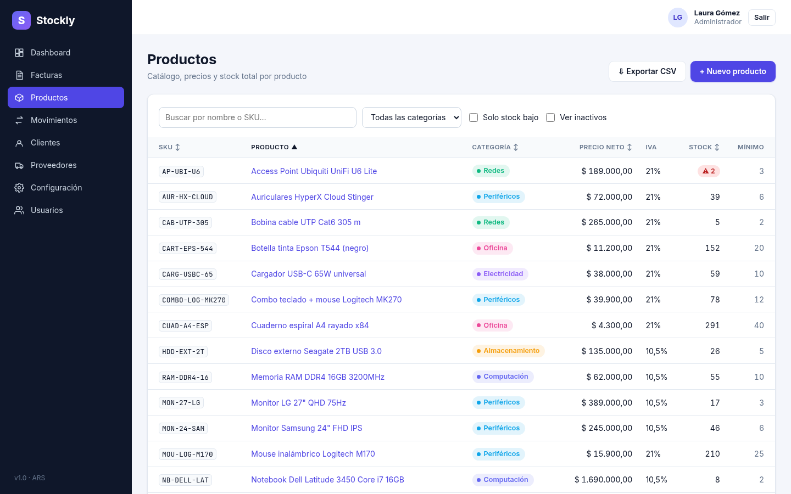    | 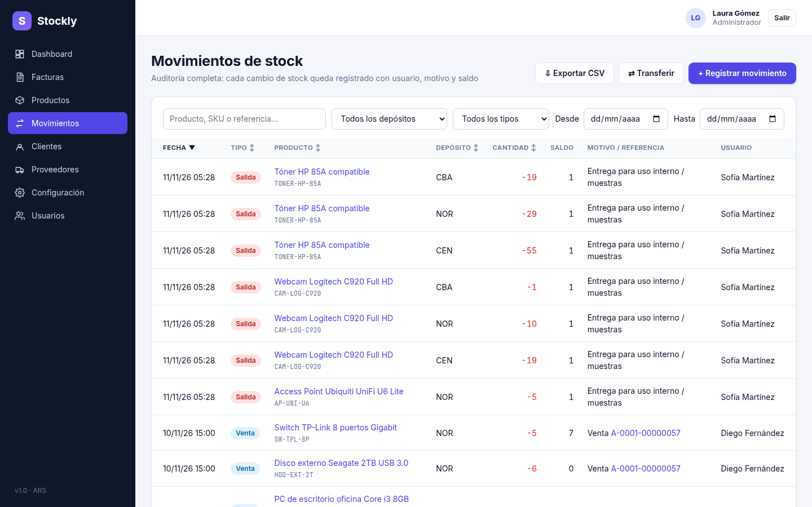   |

| Editor de factura con totales en vivo                | Detalle de factura emitida                           |
| ---------------------------------------------------- | ---------------------------------------------------- |
| 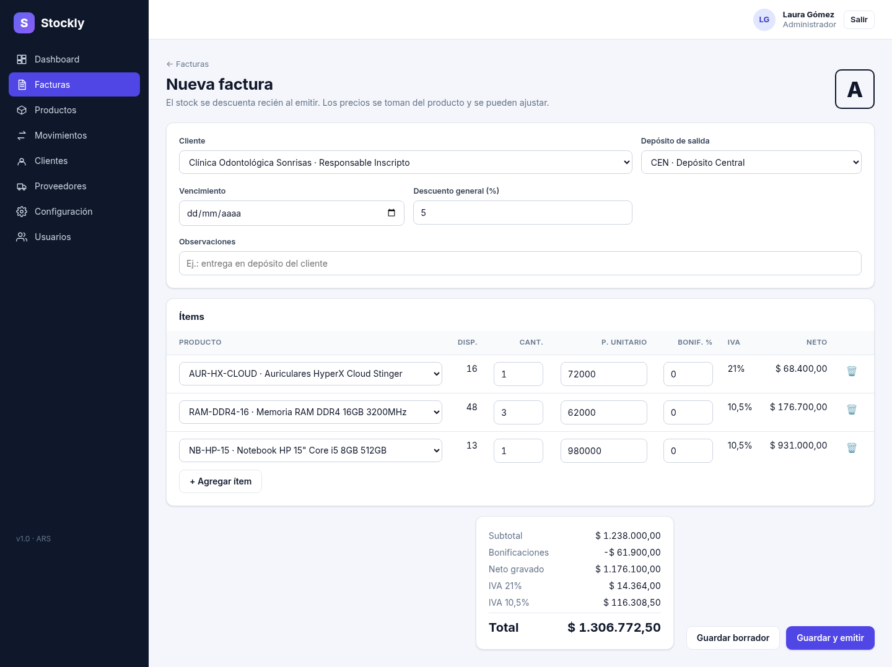       | 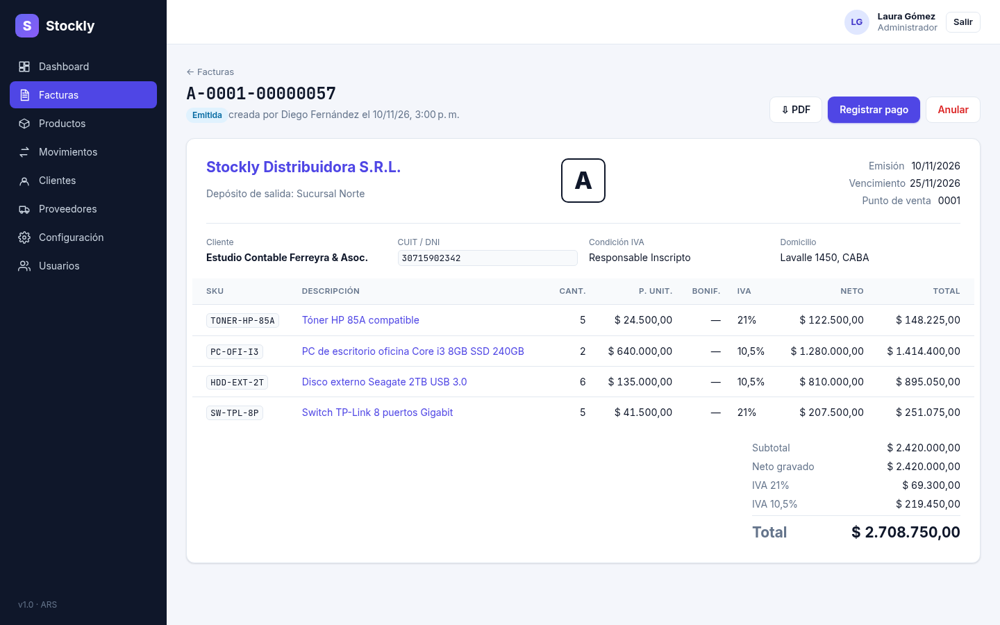      |

| Listado de facturas                           | PDF generado con QuestPDF                     |
| --------------------------------------------- | --------------------------------------------- |
| 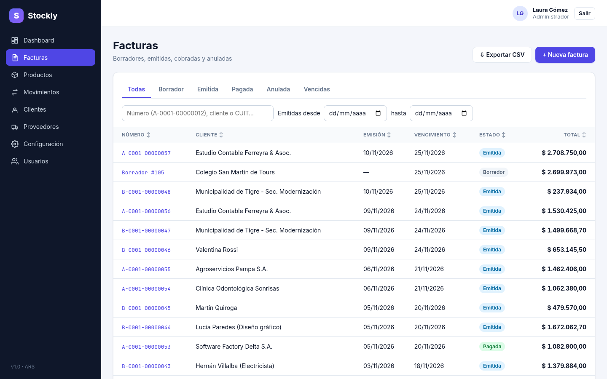    | 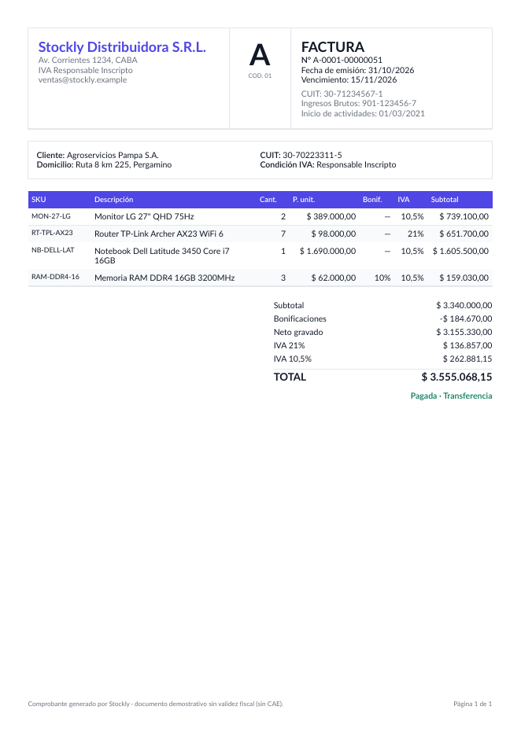      |

| Login                                    | Configuración                                   |
| ---------------------------------------- | ----------------------------------------------- |
| 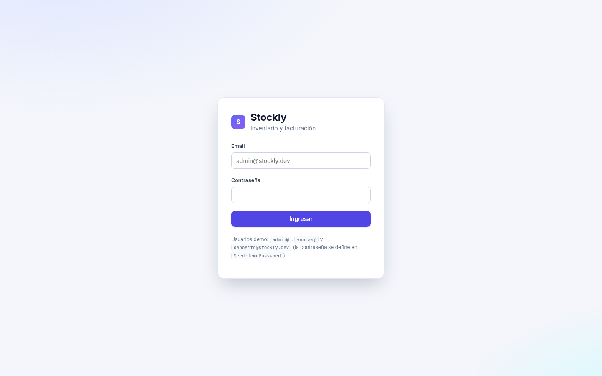     | 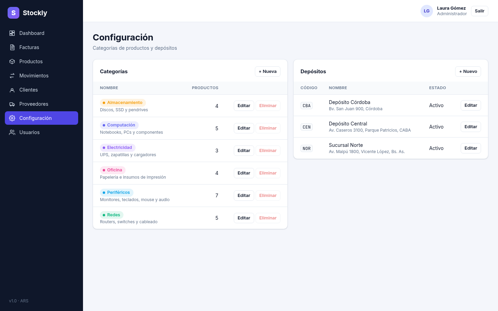 |

## 🗺️ Próximos pasos

- Notas de crédito para anular facturas ya cobradas.
- Integración con los web services de AFIP/ARCA (CAE) para facturación electrónica real.
- Refresh tokens con rotación y cookie `httpOnly`.
- Tests end-to-end con Playwright.

## 📄 Licencia

MIT © Matías Acosta
